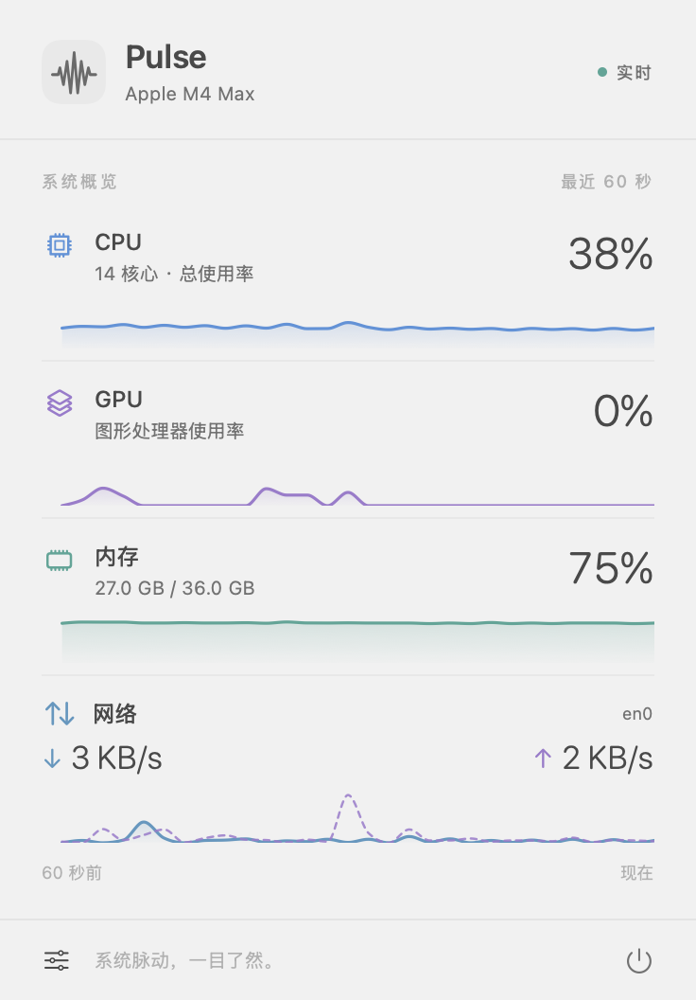

# Pulse

安静常驻的 macOS 菜单栏系统监控。Swift、AppKit、SwiftUI 和 Swift Charts 原生实现，无第三方依赖，支持 macOS 14 及以上版本。

菜单栏用紧凑的双行布局呈现 CPU、GPU、内存和真实上传 / 下载速度。点击打开 368 pt 宽的轻量弹窗，查看最近 60 秒趋势。自动适配系统深浅色、中文 / 英文以及“减少动态效果”。按最新需求，不采集或显示电量。



[查看深色界面](docs/images/pulse-dark.png)

## 构建和运行

只需安装 Apple Command Line Tools，无需完整 Xcode 或包管理器。

```sh
./scripts/build-app.sh
open dist/Pulse.app
```

构建脚本生成 Release 二进制、原生绘制的应用图标和 `.app` 包，并进行本机 ad-hoc 签名。也可以使用 `swift run Pulse` 开发运行。

长期使用可将 `dist/Pulse.app` 拖入“应用程序”，在弹窗左下角偏好设置中启用“登录时启动”。该开关使用 `SMAppService`；如系统要求批准，前往系统设置的登录项页面允许。默认不会自动启用登录启动。

可以分别隐藏菜单栏中的指标，并选择 1、2、3 秒刷新间隔。全部隐藏时仍保留一个波形图标作为入口。菜单栏设置不会隐藏弹窗中的完整指标。

本地构建默认只包含当前机器架构。如需向其他用户发布，需使用自己的 Developer ID 签名并公证；`SIGN_IDENTITY` 可传入构建脚本。

## 指标口径

| 指标 | 采集方式 | 行为 |
| --- | --- | --- |
| CPU | Mach `host_statistics` CPU ticks 差值 | 所有核心合计归一到 0–100%，启动时先建立基线 |
| GPU | IOKit `IOAccelerator` 的 `PerformanceStatistics` | 使用 `Device Utilization %`；多个 GPU 返回最大值，不是平均值 |
| 内存 | Mach `host_statistics64` | 非可清除的内部页 + wired + 实际压缩页，占物理内存比例；不把文件缓存算作已用 |
| 网络 | `sysctl NET_RT_IFLIST2` 的 64 位流量计数 | 逐接口差值 / 实际单调时间间隔；SystemConfiguration 确认链路状态 |

GPU 的 IOKit 查询 API 是原生 API，但驱动统计字段不是 Apple 承诺稳定的公共 GPU 利用率接口。已在本机 Apple M4 Max / macOS 26.0.1 验证；其他硬件或系统版本可能不提供字段，此时显示 `—`，不会用虚假数值或 CPU 指标替代。未使用私有 IOReport 框架、`sudo` 或 `powermetrics` 子进程。

网络统计活动的 `en*` 物理接口（Wi-Fi、以太网等），排除 loopback、AWDL、VPN 虚拟接口与桥接层，避免同一流量重复计数。统计的是链路流量，包含局域网传输，不代表互联网可达性，也不单独统计 VPN 隧道载荷。新接口先建立基线，断网显示零速率；读取失败显示 `—`，计数回退和休眠间隔不会产生虚假的速度峰值。速率单位为十进制 B/s、KB/s、MB/s、GB/s；内存采用 macOS 常见的 1024 进制 GB 展示。

## 轻量运行

- 默认 2 秒一次、utility 优先级的串行采样，150 ms 定时容差；每次使用 autorelease pool。
- 不启动采集子进程，不写监控日志，不上传数据，不使用数据库。
- 历史按真实时间裁剪为 60 秒，并设置 121 个样本硬上限；启动时不填充模拟历史。
- 休眠时停止计时器，唤醒后重建 CPU / 网络基线，清空过期历史。
- 弹窗关闭即释放 SwiftUI 图表视图；后台仅更新菜单栏，显示内容不变时跳过重绘。
- 弹窗在显示前确定尺寸并限制在屏幕可用高度内；标题与操作栏固定，中间内容可滚动。
- 每项采集独立失败，空值在图表中形成间断，不连接虚假的数据点。

## 验证

```sh
# 不依赖 XCTest，因此仅有 Command Line Tools 也可运行
swift run PulseCoreChecks

# 真实采样输出：首帧 CPU、网络为 null，等待下一帧建立速率
swift run Pulse --diagnose

# 打开实际菜单栏弹窗，检查内容是否在屏幕可见区域内，再关闭退出
swift run Pulse --verify-ui

# 收集 64 秒真实数据，导出浅色 / 深色界面后退出
# 运行时避免重复启动其他 Pulse 实例
swift run Pulse --capture-previews docs/images
```

核心检查覆盖 CPU tick 回绕、64 位网络计数、实际采样间隔、多接口、网络切换、计数重置、断网恢复、休眠间隔、历史边界、格式化和本机原生 API。

## 代码结构

- `Sources/PulseCore`：独立采集、计数差值、历史窗口和格式化。
- `Sources/Pulse`：菜单栏与 Popover 生命周期、采样调度、SwiftUI 界面和图表。
- `Tests/PulseCoreTests`：可直接运行的核心边界和集成检查。
- `scripts`、`Resources`：应用打包与图标生成。

设计与接口参考：[NSStatusBar](https://developer.apple.com/documentation/appkit/nsstatusbar)、[NSPopover](https://developer.apple.com/documentation/appkit/nspopover)、[Mach host_statistics64](https://developer.apple.com/documentation/kernel/1502863-host_statistics64)、[Apple 开源路由接口头文件](https://github.com/apple-oss-distributions/xnu/blob/main/bsd/net/if.h)。
